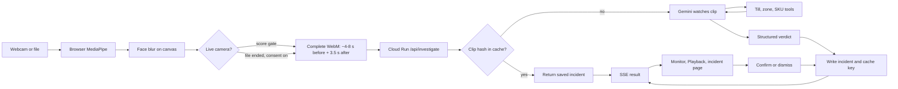
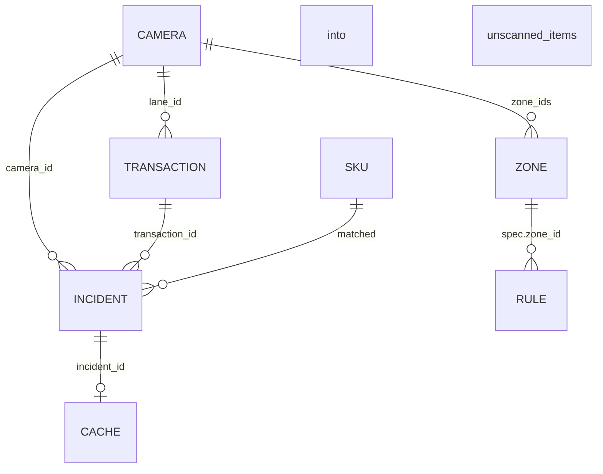

# ShrinkSight

> *Sees what the till missed.*

**Theme:** Retail & Commerce: Intelligent Customer and Business Experiences · Google Cloud AI Builder Cup 2026

ShrinkSight is a two-tier loss-prevention system. On-device vision (MediaPipe, in the browser) flags suspicious
moments. A Gemini agent then investigates each one: it watches the clip, cross-checks it against the till log
through tool calls, and returns a structured, evidence-backed incident, or rejects the false alarm.

- **Live URL:** https://shrinksight-app.web.app — click **Enter the demo store** (no sign-up; you are the manager of
  the synthetic Demo Mart, with full access)

### What you can try
| Page | What it does |
|---|---|
| **Overview** (`/`) | What ShrinkSight does, how the two tiers work, architecture |
| **Monitor** (`/monitor`) | Camera wall with live alert rail (Firestore real-time), false-alarm funnel. **Demo mode** (on for the demo login, off for other accounts): every camera loops a demo clip and shows its stored Gemini result once, with no new Gemini calls |
| **Playback** (`/playback`) | Search incidents by date, camera and event; replay the incident timeline |
| **Live edge** (`/edge`) | Tier 1 on this device: MediaPipe pose/face/objects, on-device face blur, score gate → Gemini |
| **Incident** (`/incident?id=…`) | Gemini's verdict, agent steps, *seen on camera vs. till receipt*, estimated loss in ₹, human Confirm / Dismiss |
| **Investigate a clip** (`/investigate`) | Upload or record a clip → Gemini agent (video understanding + tool calls + structured output) → new incident, with live progress. Optional **Screen with Tier-1 first**: the on-device gate and hand measurements (shelf contacts, hand rests, checkout trips vs receipt) are shown first, then sent to Gemini as moments to look at |
| **Rules** (`/rules`) | Plain-English rule → Gemini structured rule → validated → saved and toggleable. **Threat rules** ("alert if anyone points a gun"): an on-device aiming pose sends the clip, Gemini confirms the weapon, and the Monitor raises an urgent alert for a person to verify |
| **Setup check** (`/setup`) | Verifies Cloud Run, Firestore, Storage, Auth and Gemini |

**How self-checkout accuracy works:** Gemini lists every item handled and matches each one to a till receipt
line; an item counts as unscanned only if no line matches. Answers that contradict the receipt are re-asked once,
then marked inconclusive instead of raising a false alarm. Each camera's scanner and bagging areas are marked once
(or suggested by Gemini from a frame) and drawn onto the stills Gemini sees, so any camera angle works.
Before the video is watched, a separate image-only call lists every item in the marked item pile (whole pile plus
zoomed halves, brightened for dark items); the list is shown as editable chips, numbered on the close-up, and Gemini
must account for every numbered item. Measured with the [evaluation harness](eval/README.md), including
`--repeat` runs for stability.

**How an investigation stays fast:** the server looks up the receipt (or zone policy) first, so Gemini watches the
clip **once** (stills, zone close-ups and the video in a single call) with low thinking. A re-check only happens
if the answer contradicts the receipt. Everything runs inside a 50-second budget; if a model is overloaded, backup
models take over automatically. Each incident records where the time went.

**Ask about this incident:** a Gemini agent with function calling answers questions such as "Has this lane had
other missed scans today?" by looking up incidents, receipts, zone policies and prices, and shows each lookup.
## Data flow

A live clip is not stored on the server. Gemini sees the clip (from Live edge: a short face-blurred WebM), then only
the incident and a cache pointer are kept. For replay, your own browser keeps its copy for 24 hours (IndexedDB, on
your device only; deleted on sign-out, or from Profile).



## Store

`FirestoreRepo` on Cloud Run, `MemoryRepo` locally. Same collections. Seed version lives in `meta/seed`. `counters` are daily rate limits.



## Learning from the store
- **Camera memory:** when staff confirm or dismiss an alert, they pick a reason. The newest few decisions per camera go
  into later Gemini prompts as short examples, so a repeat of a dismissed situation is recognised ("like the 2 Oct
  personal phone case"). The till receipt check always has the final say.
- **Self-calibrating edge gate:** if most edge alerts on a camera turn out to be false alarms, the browser gate gets one
  step stricter, live via Firestore `onSnapshot`, with an explanation and Undo.
- **Scanner reference photo:** an optional photo of a checkout's scanner (per camera, or per uploaded clip) so only
  passes over that device count as scans.
- **Token log:** tokens per investigation on the incident page and in the eval report.

- **Plan:** [`docs/PLAN.md`](docs/PLAN.md) · **Architecture:** [`docs/ARCHITECTURE.md`](docs/ARCHITECTURE.md) ·
  **Setup & deployment:** [`docs/SETUP_AND_DEPLOYMENT.md`](docs/SETUP_AND_DEPLOYMENT.md) ·
  **New teammate?** [`docs/TEAMMATE_SETUP.md`](docs/TEAMMATE_SETUP.md) ·
  **Google login:** [`docs/GOOGLE_LOGIN_SETUP.md`](docs/GOOGLE_LOGIN_SETUP.md)

## Google AI & Cloud services
| Service | Used for |
|---|---|
| Gemini API (AI Studio) | Tier-2 investigation agent (video understanding, function calling, structured output) |
| MediaPipe Tasks Vision | Tier-1 on-device detection *(coming)* |
| Cloud Run | FastAPI investigation API |
| Firebase Hosting | Static web app + `/api/**` rewrite to Cloud Run |
| Firestore · Cloud Storage · Secret Manager | Incidents & cache · evidence clips (24 h) · Gemini key |
| Firebase Auth | Anonymous sessions |

## Repository layout
```
api/     FastAPI service (Python 3.12, uv) → Cloud Run
web/     Next.js static export (TypeScript) → Firebase Hosting
infra/   one-time Google Cloud setup script (Cloud Shell)
docs/    plan, architecture, setup & deployment guides
.github/ CI/CD (tests on every PR, keyless deploy on merge to main)
```

## Local development
**API**
```bash
cd api
uv sync                       # installs deps from uv.lock
uv run pytest -q              # tests (no cloud access needed)
uv run ruff check .
cp ../.env.example .env       # then type your own Gemini key into api/.env
set -a; . ./.env; set +a
# REPO_BACKEND=memory runs without Google credentials (seed data in memory, resets on restart)
REPO_BACKEND=memory CORS_ORIGINS=http://localhost:3000 uv run uvicorn app.main:app --reload --port 8080
```

**Web**
```bash
cd web
npm install
NEXT_PUBLIC_API_BASE=http://localhost:8080 npm run dev   # http://localhost:3000
```

**Environment variables (API)**

| Name | Purpose |
|---|---|
| `GEMINI_API_KEY` | Gemini key (Secret Manager in production; your own `.env` locally) |
| `GEMINI_MODEL` | Optional model override (default in `api/app/config.py`) |
| `GCP_PROJECT` | Google Cloud project (`shrinksight-app`) |
| `EVIDENCE_BUCKET` | Evidence bucket (`shrinksight-app-evidence`) |
| `GEMINI_INVESTIGATOR_MODEL` | Optional model for clip investigations (defaults to `GEMINI_MODEL`) |
| `REPO_BACKEND` | `firestore` (default) or `memory` for local runs |
| `CORS_ORIGINS` | Local dev (`http://localhost:3000`), or the Hosting origin if streaming goes direct to Cloud Run |

## Deployment
Merging to `main` makes GitHub Actions run the tests, build the API image, deploy it to Cloud Run, deploy the
web app and Firestore rules to Firebase Hosting, and smoke-test the live URL. Authentication is keyless
(Workload Identity Federation); the repo holds no secrets. See `docs/SETUP_AND_DEPLOYMENT.md` Part D.

## Data & licences
All data is synthetic or footage staged by the team with signed consent. No real customer data or PII.
