# ShrinkSight — Architecture & Flows

> Companion to `PLAN.md`. Theme: **Retail & Commerce**. All diagrams are Mermaid (they render on GitHub) and can be
> exported straight into the deck. Status: **design, awaiting approval** — names, thresholds and quotas are
> starting points to be tuned during the day-1 spikes.

---

## 1. The idea in one picture

```
   ┌──────────────── STORE / JUDGE'S BROWSER ("the edge") ────────────────┐      ┌──────── GOOGLE CLOUD ────────┐
   │                                                                       │      │                              │
   │  Camera / seeded clip ──► TIER 1: MediaPipe (on device, 15–30 fps)    │      │  TIER 2: Gemini agent        │
   │                            • pose, objects, hands, faces              │      │  on Cloud Run                │
   │                            • faces BLURRED here                       │      │   • watches the clip         │
   │                            • cheap rules → suspicion score            │ clip │   • calls tools (POS, zones, │
   │                            • 95%+ of frames end here (free)          ─┼─────►│     prices)                  │
   │                                                                       │ ≤3MB │   • returns a structured     │
   │  Incident console ◄──── live updates (Firestore) ◄────────────────────┼──────┤     verdict + evidence       │
   │                                                                       │      │                              │
   └───────────────────────────────────────────────────────────────────────┘      └──────────────────────────────┘
```

**The rule of thumb:** Tier 1 is fast, free and says "this *might* be something." Tier 2 is smart, rate-limited and
answers "is it, what exactly happened, and what did it cost?" Only blurred, short, suspicious clips ever cross the line.

---

## 2. System context

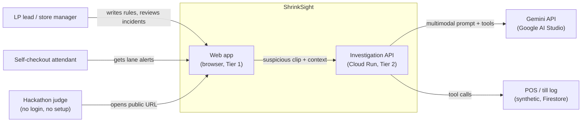

---

## 3. Components

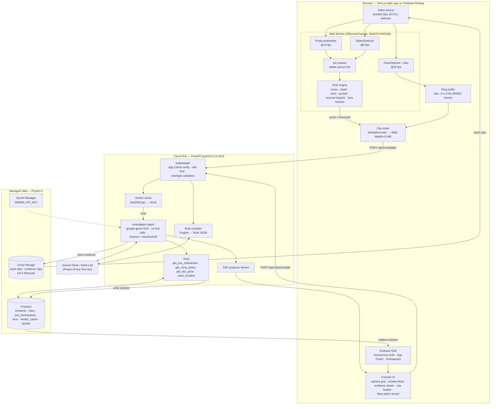

| Component | Responsibility | Why it lives there |
|---|---|---|
| Web Worker + MediaPipe | All per-frame computer vision | Free compute on the judge's machine; keeps the UI thread smooth |
| Rule engine | Turns landmarks into a 0–1 suspicion score | Cheap, explainable, runs 15+ times per second |
| Ring buffer + clip cutter | Pre/post-event evidence (like the PDF's rolling buffer) | Only blurred frames are kept, so raw video never leaves the device |
| Gatekeeper | Abuse protection and input validation | Public URL + free key = must be defended |
| Verdict cache | Instant, quota-free answers for seeded clips | Judges always see a result, even with no quota left |
| Investigator agent | The Gemini reasoning loop with tools | The core Gen AI mechanic (40% of the score) |
| Rule compiler | English → structured rule for Tier 1 | Gen AI that configures the system, not just chats |
| Firestore | System of record + realtime push to the console | Free, serverless, no websocket server to run |

---

## 4. Deployment topology ($0)

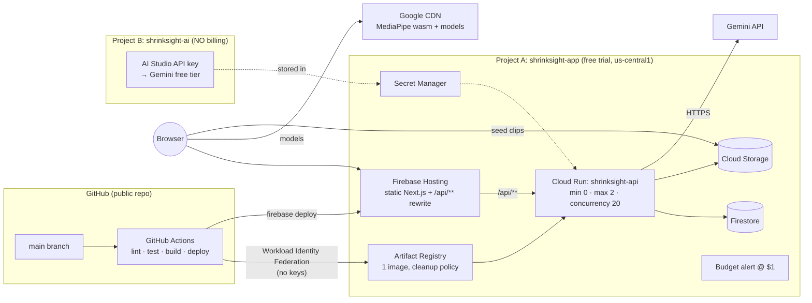

**Why two projects:** a Gemini key from a billing-enabled project is billed at paid rates. A key from a project with
no billing stays on the free tier. The free-trial account in Project A can't charge the card unless someone
manually upgrades it.

---

## 5. Tier 1 in the browser: frame-level pipeline

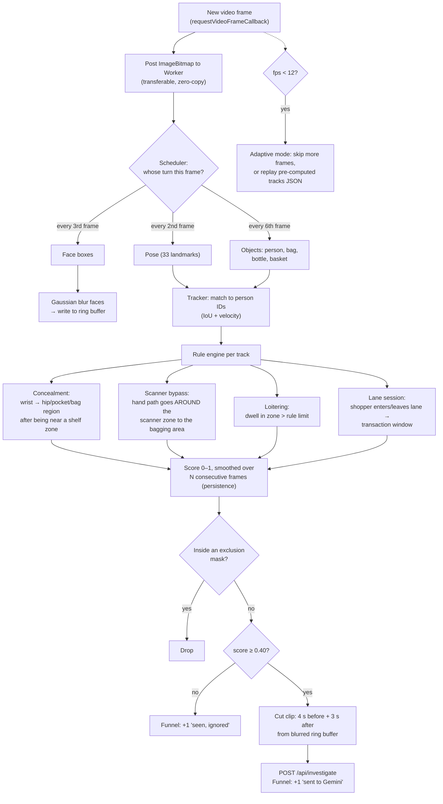

**Starting thresholds (tuned on the eval set):**
- Send to Gemini if the score is ≥ 0.40 for at least 8 frames in a row.
- For the self-checkout lane, *always* send the whole transaction window when the shopper leaves the lane. The
  cross-check needs the full session, not just one suspicious moment.

---

## 6. Flow A: judge opens the URL

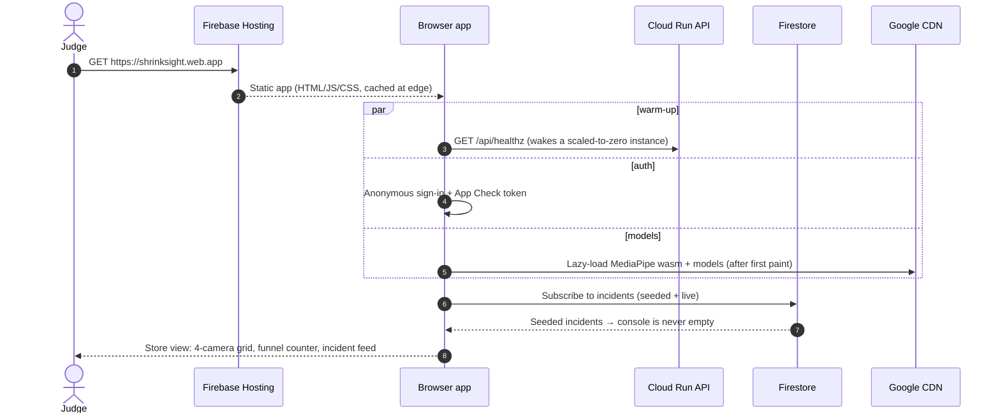

---

## 7. Flow B (hero): self-checkout cross-check against the till

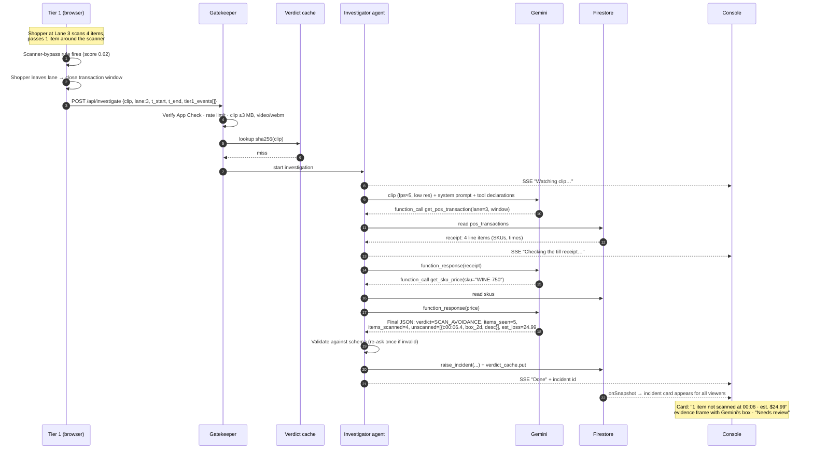

**Why only Gemini can do this:** it has to understand *which object* was handled, *count* items across time, and
*reason over two modalities at once* (video and a till receipt fetched through a tool). Classical CV would need a
custom-trained model per store and a separate rule system for the receipt.

**Fallback if the day-1 spike shows Gemini counts poorly:** Tier 1 already logs each hand-crossing with a timestamp.
The agent asks Gemini about each crossing separately ("between 00:06.0 and 00:07.0, did the item pass over the
scanner?") and reconciles the counts in deterministic code.

---

## 8. Flow C: shop-floor concealment and rejecting a false alarm

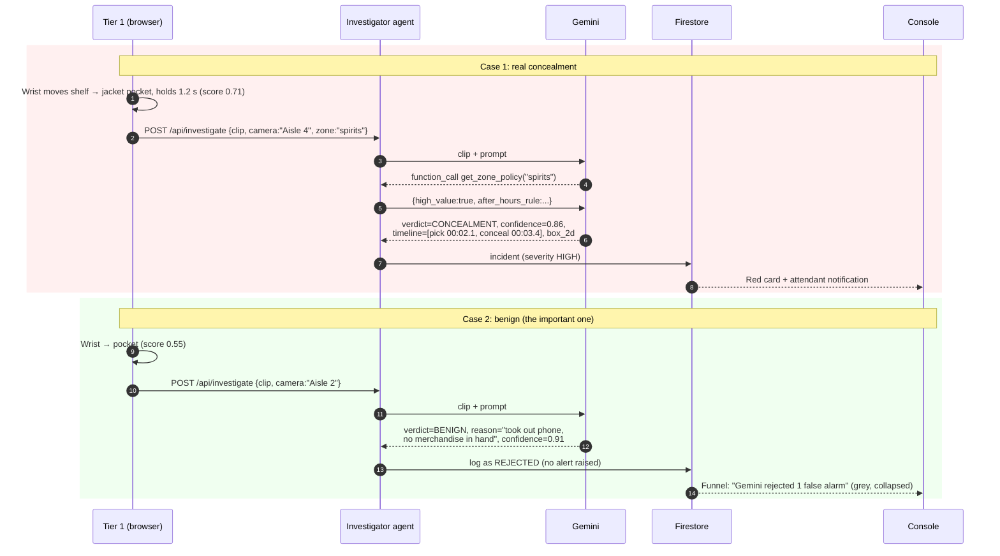

---

## 9. Flow D: plain-English rule → enforced by Tier 1

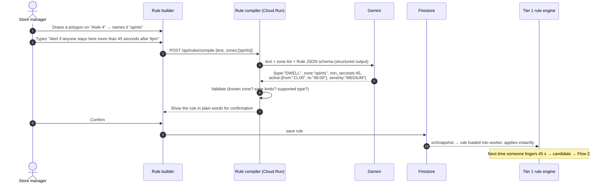

Supported rule types (MVP): `DWELL`, `CONCEALMENT_SENSITIVITY`, `ZONE_ENTRY`, `SCANNER_BYPASS`. Anything else is
rejected with a friendly "I can't enforce that yet" message, so the model never invents a rule the engine can't run.

---

## 10. Flow E: cache, rate limits and graceful degradation

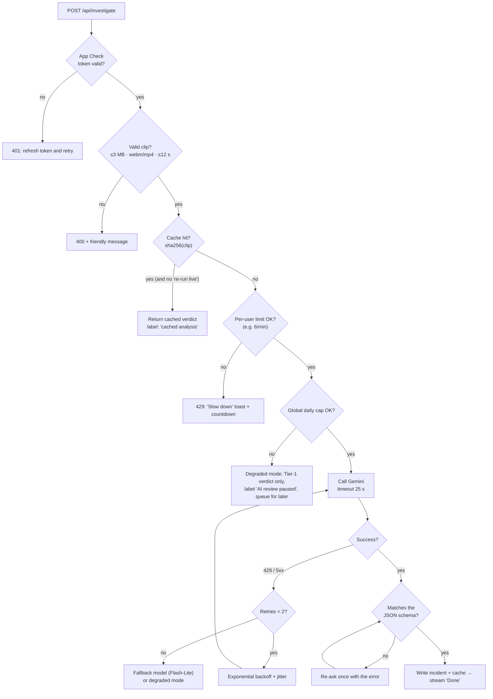

---

## 11. Incident lifecycle

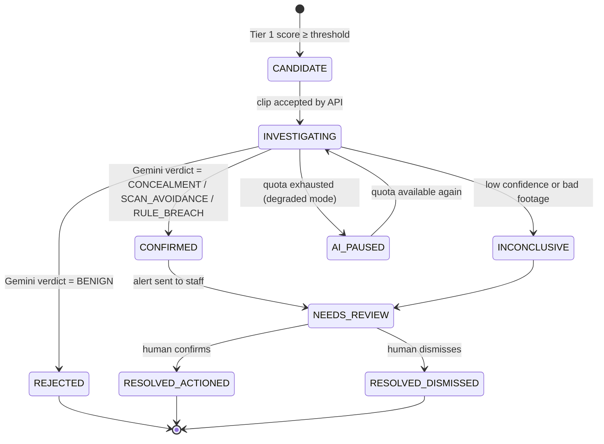

A human decision is always the last step. ShrinkSight never labels a person a thief; it flags events for review.
Human dismissals are also logged, which gives us a precision metric for the deck.

---

## 12. Data model (Firestore)

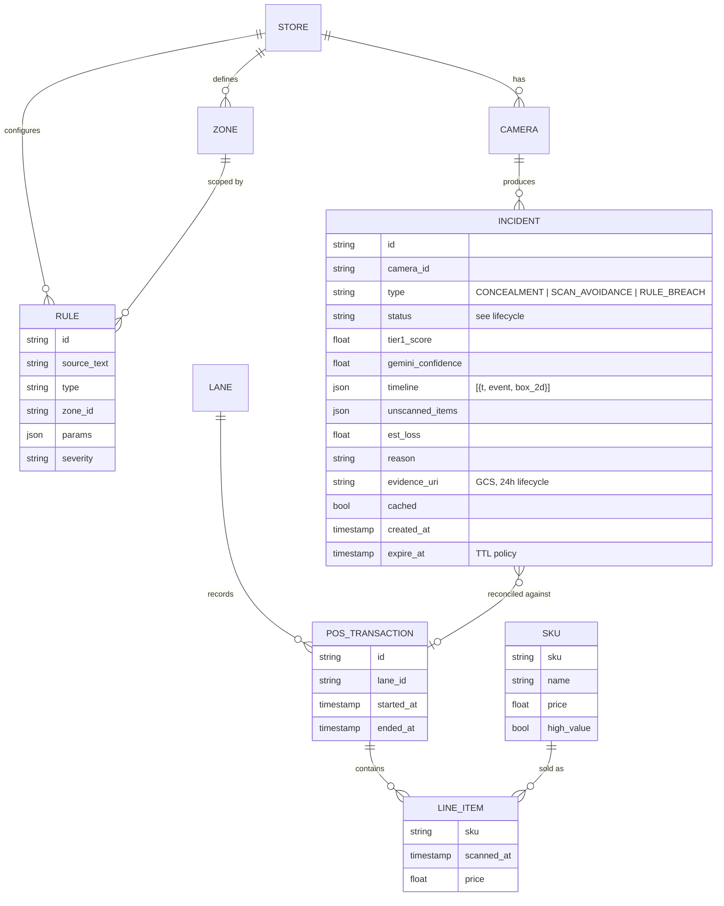

Other collections: `verdict_cache/{sha256}` (verdict JSON, model id, created_at) and `quotas/{uid|global}`
(rolling counters). All POS, SKU and store data is **synthetic** and lives in `/seed`.

---

## 13. API contract (Cloud Run)

| Method & path | Purpose | Request | Response |
|---|---|---|---|
| `GET /api/healthz` | Warm-up / liveness | — | `{ok, model, version}` |
| `POST /api/investigate` | Run the Gemini agent on a clip | multipart: `clip` (webm/mp4 ≤3 MB), `meta` JSON `{camera_id, lane_id?, zone_ids[], t_start, t_end, tier1_events[], rerun_live?}` | `text/event-stream`: `progress` events → final `result` `{incident_id, verdict…}` |
| `POST /api/rules/compile` | English → Rule JSON | `{text, zones[]}` | `{rule, explanation}` or `{error}` |
| `GET /api/stats` | Funnel and eval numbers for the UI | — | `{tier1_candidates, gemini_confirmed, rejected, avg_latency_ms}` |

Every request needs an App Check header and a Firebase anonymous ID token. Validation errors return 400 with
human-readable messages; quota errors return 429 with `retry_after`.

---

## 14. Gemini contracts

**Tools (function declarations):**

| Tool | Args | Returns | Notes |
|---|---|---|---|
| `get_pos_transaction` | `lane_id`, `t_start`, `t_end` | line items with SKU, name, scan time | Read-only |
| `get_zone_policy` | `zone_id` | high-value flag, active rules | Read-only |
| `get_sku_price` | `sku` or `description` | name, price | Fuzzy match on description |
| `raise_incident` | type, severity, summary | incident id | Server checks the args; the model can't skip schema validation |

**Final response schema (structured output, simplified):**

```json
{
  "verdict": "CONCEALMENT | SCAN_AVOIDANCE | RULE_BREACH | BENIGN | INCONCLUSIVE",
  "confidence": 0.0,
  "items_seen": 0,
  "items_scanned": 0,
  "unscanned_items": [{ "t": "00:06.4", "description": "green wine bottle", "box_2d": [ymin, xmin, ymax, xmax] }],
  "timeline": [{ "t": "00:02.1", "event": "picks item from shelf" }],
  "est_loss": 0.0,
  "reason": "one or two plain sentences",
  "behaviour_only": true
}
```

**Prompt principles:** describe **actions only** (never appearance, clothing as identity, age, gender or ethnicity);
say INCONCLUSIVE rather than guess; timestamps are relative to the clip start; bounding boxes use Gemini's native
0–1000 `box_2d` format so the UI can overlay them directly.

**Model choice (set in config, confirmed on day 1):** Flash for investigations, Flash-Lite for rule compiling and as
the fallback model.

---

## 15. Security and privacy boundaries

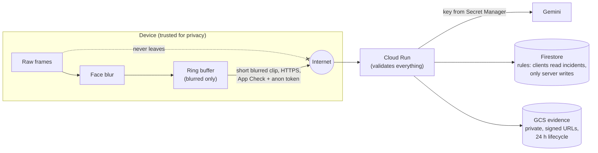

- Raw video never leaves the device; only short, face-blurred clips are uploaded.
- Evidence is deleted after 24 hours (GCS lifecycle + Firestore TTL).
- Firestore security rules: the browser can **read** incidents and rules, but only the server writes incidents and
  only signed-in users write rules (validated).
- No secrets in the browser or in git. The Gemini key exists only in Secret Manager.
- All demo footage is staged by team members who signed consent forms; all records are synthetic.

---

## 16. CI/CD flow

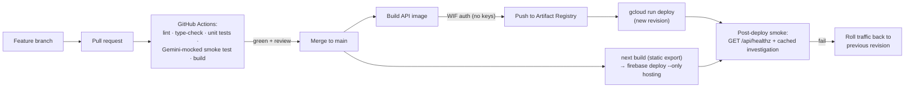

---

## 17. Latency budget (one investigation, target median < 6 s)

| Step | Budget |
|---|---|
| Clip cut + encode in browser | 0.3 s |
| Upload ≤3 MB | 0.5–1.0 s |
| Gatekeeper + cache lookup | 0.1 s |
| Gemini first pass (video understanding) | 2.5–3.5 s |
| Tool round-trips (1–2 × Firestore + Gemini) | 1.0–1.5 s |
| Validate + write + Firestore push to UI | 0.2 s |

Users see progress steps the whole time, so the wait reads as "the agent is investigating," not as a hang.

---

## 18. Production scale-up story (for the deck)

| Prototype | At 100× (real chain) |
|---|---|
| Browser runs Tier 1 | In-store edge box (Coral / Jetson / NVR plugin) runs the same rule engine |
| Direct HTTPS calls | Pub/Sub queue between stores and investigators, with back-pressure |
| Gemini Developer API free tier | Vertex AI Gemini with provisioned throughput, batch mode for overnight audits |
| One Firestore database | Per-chain tenancy, BigQuery export for shrink analytics |
| Synthetic POS | Real POS connectors (read-only), joined on lane + time |
| Cloud Run max 2 | Autoscaled; cost scales with *suspicious events*, not camera-hours, because Tier 1 filters 95%+ |

**What breaks first at 100×:** the Gemini rate limit, then Firestore hot-spotting on the incident feed. The fixes are
Vertex AI provisioned throughput and sharded per-store collections.
